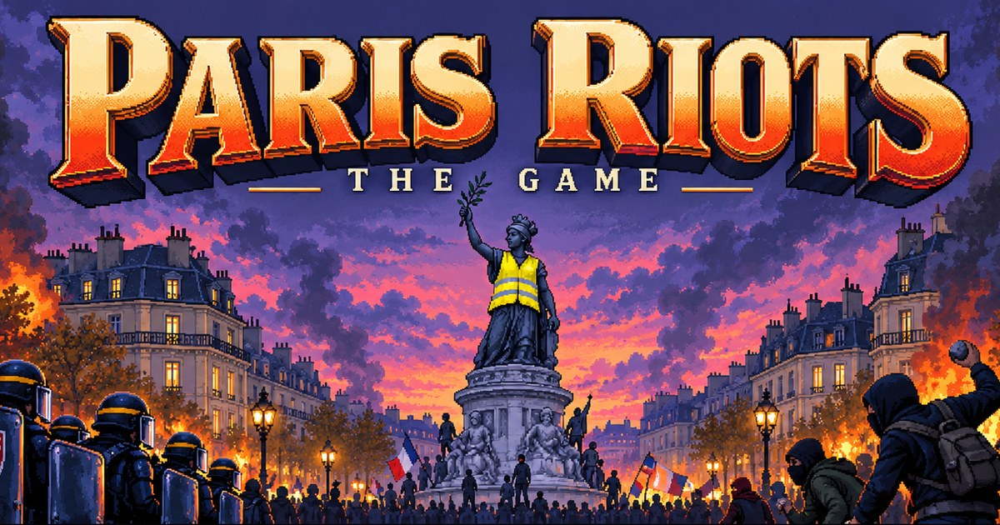

# Paris Riots: The Game

A turn-based story game on a pixel map of central Paris, set on 17 October 2026. You play the street protesters through five chapters. Curfew is at 23:00.

Play: https://couvre-feu.pages.dev (desktop browser)



## How it works

| Part | Source |
| --- | --- |
| Map | OpenStreetMap streets, water and parks for central Paris, drawn as pixel art. The game grid comes from the same drawing, so the rules match the picture. |
| Rules | Advance Wars: move a unit, then fire, capture or wait. Each chapter plays on its own patch of Paris, with its goal marked on the map. Point at a police unit to see where it can hit next turn. |
| Story | Five chapters, each with a diary card. Inès, a 16-year-old protester, briefs you at the start of each chapter, introduces each new unit, and coaches you through each step. |
| Art | Painted with Codex in a fixed 32-colour palette. |
| Music | Ten French songs from BitMidi, played on a four-channel Game Boy-style synth from [Wario Synth](https://wario.style). |

The game is one page with a canvas and no libraries. It runs on Cloudflare Pages.

## Run it

```
python3 -m http.server -d game 8000
```

Then open http://localhost:8000.

## Folders

| Folder | Contents |
| --- | --- |
| `game/` | The game. Deploy this folder. |
| `data/` | Scripts that turn OpenStreetMap data into the map and its grid. |
| `art/` | Palette, sprite sheets, source paintings and the art build scripts. |

## Rebuild the map

Download the BBBike Paris extract to `data/Paris.osm.pbf`. Then run these from `data/` with Python 3 and `osmium`, `shapely` and `pillow`:

```
python extract.py Paris.osm.pbf paris.json
python render.py paris.json ../game/art/paris.png
python grid.py
python layout.py
```

`layout.py` writes `game/map.js`. From the repo root, `python data/news.py` converts the source paintings to the game palette.

## Credits

Map data © OpenStreetMap contributors, ODbL.

Music, as chiptune covers: Offenbach, Rouget de Lisle, Degeyter, Satie, Édith Piaf, Desireless, Serge Gainsbourg and Daft Punk. The songs belong to their writers.

Built with Opus and Codex, and 10,000+ hours playing Amiga games as a kid.

## Licence

MIT
